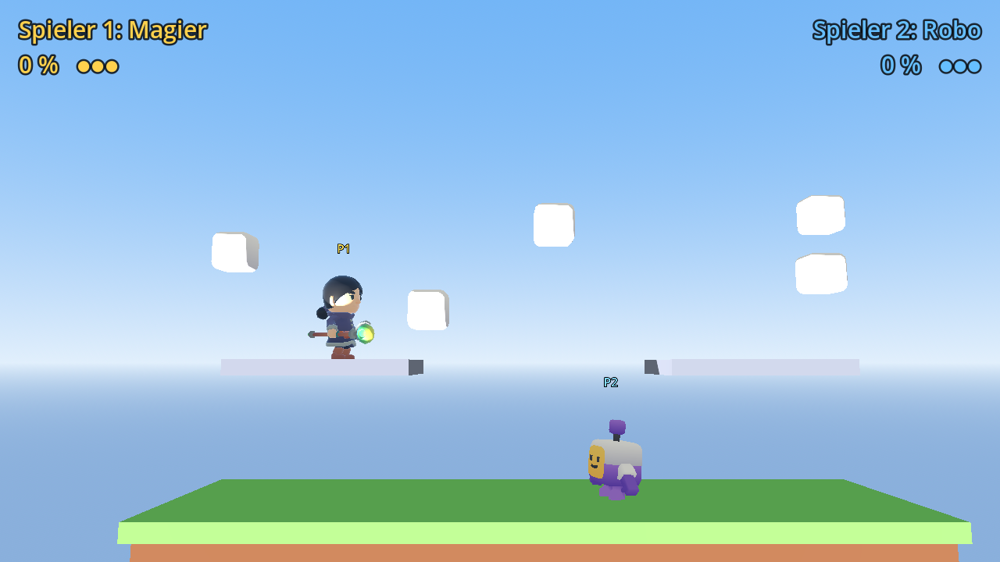

# Game

Ein Plattform-Kampfspiel für zwei Spieler an einer Tastatur, gebaut mit [Godot 4](https://godotengine.org) (getestet mit 4.3).
Wie bei Super Smash Bros. sind Figuren und Arena 3D-Modelle, gekämpft wird aber nur nach links, rechts, oben und unten.

## Kämpfer

Zehn Figuren stehen zur Wahl: Ritter, Barbar, Magier, Schurke, Kapuzen-Schurke, Skelett-Krieger, Skelett-Magier, Skelett-Schurke, Skelett-Diener und Robo.
Vor jeder Runde wählt jeder Spieler mit seinen Laufen-Tasten eine Figur und drückt Schlagen, wenn er bereit ist.

## Regeln

- Beide Spieler kämpfen auf einer Plattform.
- Es gibt keine Lebenspunkte: Jeder Treffer erhöht den Schaden (in %). Je höher der Schaden, desto weiter fliegt man beim nächsten Treffer weg.
- Wer aus der Arena fällt oder geschleudert wird, verliert ein Leben und startet mit 0 % neu.
- Wer dreimal heruntergefallen ist, hat verloren.

## Steuerung

| Aktion | Spieler 1 (gelb) | Spieler 2 (blau) |
|---|---|---|
| Laufen | A / D | Pfeil links / rechts |
| Springen (2× in der Luft möglich) | W | Pfeil hoch |
| Schlagen | F oder Leertaste | L oder Enter |
| Figur wählen (vor der Runde) | A / D | Pfeil links / rechts |
| Neustart nach Spielende | R | R |

## Starten

1. Godot 4 herunterladen und öffnen.
2. Im Projektmanager auf **Importieren** klicken und `project.godot` wählen.
3. Mit **F5** starten.

## Aufbau

- `scenes/main.tscn` ist die Arena mit Hauptplattform, zwei Plattformen zum Draufspringen (von unten durchspringbar), Licht, Himmel und Anzeige.
- `scenes/player.tscn` ist eine Kämpfer-Figur, die zweimal in der Arena steckt.
- `scripts/roster.gd` ist die Liste aller Kämpfer: Modell, Waffen und Angriffs-Animation. Hier fügst du neue Figuren hinzu.
- `scripts/player.gd` enthält Bewegung, Angriff, Schaden, Rückstoß und Animationen. Werte wie `attack_damage` oder `knockback_per_damage` lassen sich im Inspektor ändern.
- `scripts/main.gd` steuert Figurenauswahl, Kamera, Anzeige und erkennt den Sieger.
- `assets/` enthält die 3D-Modelle (alle CC0, siehe `assets/CREDITS.md`).
