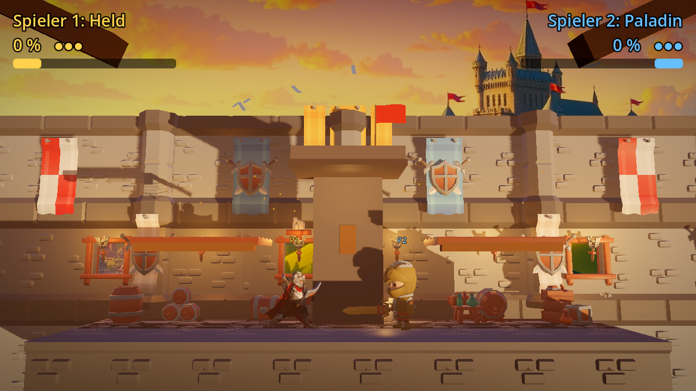
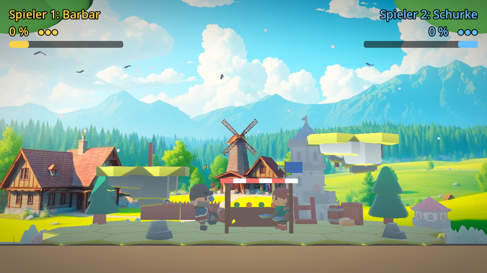
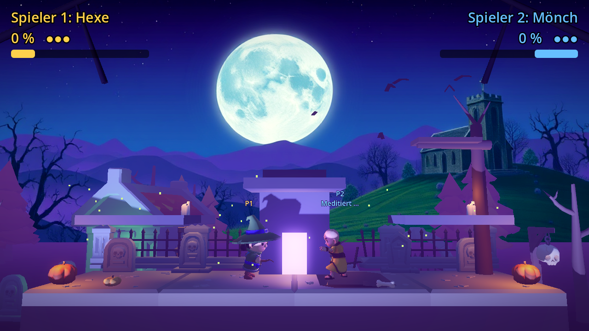

# Arena-Kampf

Ein Plattform-Kampfspiel für zwei Spieler an einer Tastatur, gebaut mit [Godot 4](https://godotengine.org) (getestet mit 4.3).
Wie bei Super Smash Bros. sind Figuren und Arenen 3D-Modelle, gekämpft wird aber nur nach links, rechts, oben und unten.

## Regeln

- Es gibt keine Lebenspunkte: Jeder Treffer erhöht den Schaden (in %). Je höher der Schaden, desto weiter fliegt man beim nächsten Treffer.
- Wer aus der Arena fällt oder geschleudert wird, verliert ein Leben und startet mit 0 % neu.
- Wer keine Leben mehr hat, hat verloren. Wie viele Leben es gibt, stellst du in den Optionen ein (Standard: 3).

## Menü

- **Kampf starten**: Danach wählt jeder Spieler mit seinen Laufen-Tasten einen Kämpfer und drückt den schwachen Angriff, wenn er bereit ist.
- **Map**: Burg, Dorf, Friedhof, Vulkan, Piratenschiff, Eiswelt oder Wolkentempel. Jede Map hat ihren eigenen Effekt (siehe unten).
- **Optionen**: Items an oder aus, wie oft Items erscheinen (selten, normal, oft), die Anzahl der Leben,
  Map-Effekte an oder aus, Spezial aufladen an oder aus, Lautstärke von Musik und Geräuschen.
- **Steuerung anpassen**: jede Taste beider Spieler neu belegen (Tastatur oder Gamepad). Ist die neue Taste
  schon belegt, tauschen die beiden Aktionen. „Standard wiederherstellen“ setzt alles zurück.

Im Menü: W/S oder Pfeile hoch/runter wählen, A/D oder Pfeile links/rechts ändern, F, J oder Enter bestätigen, Esc zurück.

## Steuerung

Standardbelegung (im Menü unter „Steuerung anpassen“ änderbar):

| Aktion | Spieler 1 | Spieler 2 |
|---|---|---|
| Laufen | A / D | Pfeil links / rechts |
| Springen (2× in der Luft möglich) | W | Pfeil hoch |
| Abwehren (gedrückt halten) | S | Pfeil runter |
| Schwacher Angriff | F | J (oder Num 1) |
| Starker Angriff | G | K (oder Num 2) |
| Tritt | H | L (oder Num 3) |
| Spezialattacke | T | I (oder Num 5) |
| Ausweichrolle | 2× schnell links oder rechts | 2× schnell Pfeil links oder rechts |
| Durch eine Plattform fallen | 2× schnell S (auf einer Plattform) | 2× schnell Pfeil runter |
| Nach dem Kampf nochmal | R | R |
| Zurück ins Menü | Esc | Esc |

## Angriffe

| Angriff | Schaden | Besonderheit |
|---|---|---|
| Schwach | 4 % | sehr schnell, kaum Rückstoß |
| Stark | 13 % | kurzes Ausholen, schleudert weit |
| Tritt | 8 % | schleudert flach zur Seite |
| Spezial | 9–11 % | je nach Kämpfer, siehe unten |

**Abwehr:** Solange du die Abwehr-Taste hältst, schützt dich eine Blase vor allen Treffern. Sie wird kleiner, je länger du sie hältst und je mehr Treffer sie abfängt. Zerbricht sie, bist du kurz betäubt.

**Ausweichrolle:** Zweimal schnell in eine Richtung tippen: Die Figur rollt ein Stück in diese Richtung und kann dabei nicht getroffen werden. Danach kurz warten bis zur nächsten Rolle.

**Spezial aufladen:** Unter den Namen oben zeigt eine Leiste die Spezial-Energie. Sie füllt sich langsam mit der Zeit,
schneller durch eigene Treffer und etwas durch Treffer, die man einsteckt. Erst bei voller Leiste (sie blinkt, über der Figur
steht „Spezial bereit!“) geht die Spezialattacke, danach ist die Leiste wieder leer. In den Optionen lässt sich das ausschalten.

Spezialattacken sind ein Spektakel: großer Schriftzug, kurze Zeitlupe, Lichtblitz und Schockwelle. Trifft eine, friert das Bild kurz ein, die Kamera wackelt und es knallt. Solange die Leiste voll ist, steigen Funken um die Figur auf.

**Spezialattacken:**
- Feuerball (Magier, Robo): fliegt geradeaus.
- Sturmangriff (Schurke): schneller Stoß nach vorne.
- Wirbel (Barbar): trifft vorne und hinten.
- Himmelshieb (Held): springt hoch, schlägt nach oben und rettet dich zurück auf die Plattform.
- Lichtschild (Paladin): 1,6 Sekunden unverwundbar in einer Lichtkuppel, dann explodiert sie und schleudert alle in der Nähe weg.
- Erdbeben (Brummbart): kleiner Sprung, dann ein Stampfer, dessen Schockwelle weit über den Boden läuft.
- Frostzauber (Hexe): Eiskugel, die den Gegner kurz einfriert. Ein Treffer befreit ihn wieder.
- Pfeilregen (Jägerin): Ein leuchtender Kreis markiert die Stelle des Gegners, dann regnen Pfeile herab.

## Kämpfer und passive Fähigkeiten

Jeder Kämpfer hat zusätzlich eine passive Fähigkeit, die immer wirkt:

| Kämpfer | Spezial | Passiv |
|---|---|---|
| Barbar | Wirbel | Berserker: je mehr Schaden er hat, desto härter schlägt er (bis +40 %) |
| Magier | Feuerball | Arkane Quelle: Spezial lädt 60 % schneller |
| Schurke | Sturmangriff | Kritisch: 25 % Chance auf doppelten Schaden |
| Robo | Feuerball | Panzerung: nimmt 20 % weniger Schaden, etwas langsamer |
| Held | Himmelshieb | Heldenmut: ab 80 % Schaden 30 % stärker |
| Paladin | Lichtschild | Heilung: heilt sich langsam, wenn er 3 Sekunden nicht getroffen wird |
| Brummbart | Erdbeben | Schwergewicht: wird 25 % weniger weit geschleudert, trotzt dem Wind, springt etwas niedriger |
| Hexe | Frostzauber | Gleiten: Sprungtaste in der Luft halten, um langsam zu schweben |
| Jägerin | Pfeilregen | Flink: läuft schneller und springt dreimal |
| Mönch | Hundert Fäuste: sechs blitzschnelle Schläge mit goldenen Faust-Abdrücken, der letzte schleudert weg | Innere Ruhe: wer still steht, meditiert und lädt das Spezial doppelt so schnell |

## Map-Effekte

Jede Map hat ihren eigenen Aufbau (z. B. Wehrturm in der Burg, Marktstand im Dorf, Gruft und Baum auf dem Friedhof,
Ausguck am Mast auf dem Piratenschiff, Spalte in der Eiswelt) und einen eigenen Effekt:

- **Burg**: Kanonenkugeln fliegen quer über die Arena, mal auf Bodenhöhe, mal auf Höhe der Plattformen.
  Ein blinkendes rotes Ausrufezeichen zeigt vorher, von welcher Seite.
- **Dorf**: Windböen schieben alle Kämpfer für ein paar Sekunden zur Seite, in der Luft stärker als am Boden.
  Pfeile kündigen die Richtung an.
- **Friedhof**: weniger Schwerkraft, man springt höher und fliegt weiter. Leuchtende lila Kreise am Boden zeigen,
  wo gleich ein Geist hochschießt und alle darüber nach oben schleudert.
- **Vulkan**: Lavafontänen schießen an glühenden orangen Kreisen aus dem Boden und schleudern alle darüber nach oben.
- **Piratenschiff**: Seegang. Das Schiff schaukelt, und Wellen schieben alle Kämpfer für ein paar Sekunden zur Seite.
- **Eiswelt**: spiegelglatter Boden, man rutscht beim Laufen und Bremsen. Eiszapfen fallen auf die blauen Kreise.
- **Wolkentempel**: Blitze schlagen an gelben Kreisen ein und schleudern alle in der Nähe weg.

## Sound

Jede Map und das Menü haben eigene Musik. Schläge, Treffer, Sprünge, Abwehr, Items und Map-Effekte haben Geräusche.
Ein Ansager zählt „Drei, zwei, eins, Kampf!“ herunter und verkündet den Sieger, die Kämpfer rufen beim Zuschlagen und
Getroffenwerden (der Barbar tiefer, der Robo höher).

## Items

Wenn Items eingeschaltet sind, fallen sie im Kampf vom Himmel. Berühren reicht:

- **Heiltrank**: 30 % weniger Schaden
- **Goldschwert (Kraft)**: 10 Sekunden lang härter zuschlagen
- **Goldmünzen (Tempo)**: 10 Sekunden lang schneller laufen und höher springen
- **Bombe**: explodiert kurz nach der Berührung und schleudert alle in der Nähe weg

## Starten

1. Godot 4 herunterladen und öffnen.
2. Im Projektmanager auf **Importieren** klicken und `project.godot` wählen.
3. Mit **F5** starten.

## Aufbau

- `scenes/menu.tscn` / `scripts/menu.gd`: Hauptmenü und Optionen.
- `scenes/fight.tscn` / `scripts/fight.gd`: der Kampf mit Kämpferauswahl, Kamera, Anzeige und Items.
- `scenes/maps/`: die drei Maps. Du kannst sie in Godot öffnen und Deko verschieben. Die Kollision steckt in `Stage`, `LeftPlatform` und `RightPlatform`.
- `scenes/player.tscn` / `scripts/player.gd`: ein Kämpfer mit Bewegung, Angriffen, Abwehr und Animationen. Die Werte aller Angriffe stehen oben in `ATTACKS`.
- `scripts/roster.gd`: die Liste aller Kämpfer mit Modell, Waffen, Animationen und Spezialattacke.
- `scripts/item.gd`, `scripts/projectile.gd`: Items und Feuerbälle.
- `scripts/settings.gd`: gespeicherte Einstellungen.
- `assets/`: die 3D-Modelle (alle CC0, siehe `assets/CREDITS.md`).
